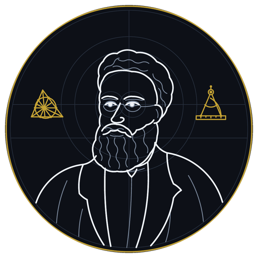

GEOMETOR • lemoine
==================

**Visit the Online Archive:** https://geometor.github.io/lemoine/

**Émile Lemoine • La Géométrographie • semantic digital archive**

Mission
-------

``geometor/lemoine`` is part of the interconnected `GEOMETOR <https://geometor.com>`_ semantic digital archive. It preserves and formalizes Émile Lemoine's *La Géométrographie* (1902), the foundational treatise establishing a rigorous algebraic calculus of operation counts, simplicity, and exactitude for ruler-and-compass constructions. Through addressable semantic units, calibrated theme-adaptive vector diagrams, primary-source folio provenance, and exact symbolic operation validators, Lemoine's metrics bridge classical Euclidean geometry with modern algorithmic complexity across the GEOMETOR corpus.

Books in This Archive
---------------------

- `Geometrography <https://geometor.github.io/lemoine/geometrographie/>`_ — *La Géométrographie, ou Art des constructions géométriques* (1902), establishing exact elementary operation counts (:math:`R_1, R_2, C_1, C_2, C_3`), simplicity (:math:`S`), and exactitude (:math:`E`) for classical and modern geometric constructions.

Repository Contents
-------------------

- ``docsrc/`` — RST documentation source, 4-track study codex, and Sphinx docs compiled by `PHOTON publish <https://github.com/photon-platform/publish>`_.
- ``resources/`` — Primary-source folios, facsimile page images, and archival witness registries.
- ``src/geometor/lemoine/`` — Python operation-count validation engine, SHA-256 witness verifier, and apparatus compiler.

Local Build & Verification
--------------------------

.. code-block:: bash

   publish build
   uv run --no-sync pytest

Part of the GEOMETOR Knowledge Archive
--------------------------------------

Explore all **74 Book Codices** and **11 Mathematical Catalogs** at https://geometor.com/books/.
