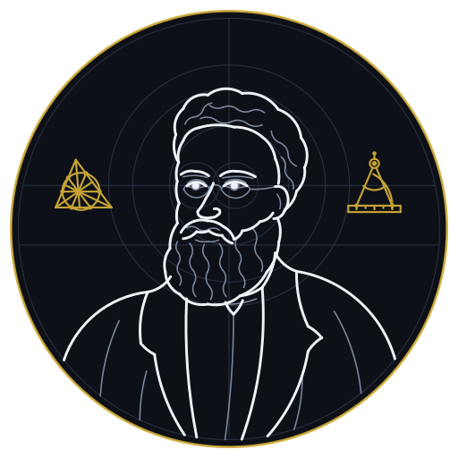

.. container:: author-overline

   semantic digital archive • the works of

=============
Émile Lemoine
=============

**Émile Lemoine** (1840–1912)—co-discoverer of the symmedian point :math:`X(6)` and Lemoine circle—asked a disarmingly practical question: how many times do you actually set your straightedge and compass in a geometric proof? In *La Géométrographie*, he reduced every ruler-and-compass construction to five elementary operations (:math:`R_1, R_2, C_1, C_2, C_3`), turning simplicity and exactitude into a measurable calculus.

Books in This Collection
------------------------

.. container:: home-book-hero

   .. container:: home-book-thumb plate-light

      .. image:: geometrographie/part_03_circles_and_tangency/17_golden_section_and_inaccessible_xxxvi_xxxvii/0044.g1.png
         :alt: Émile Lemoine 1893 Figure 8 — One-line Golden Section geometrographic construction
         :target: geometrographie/index.html

   .. container:: home-book-body

      .. rubric:: AFAS Pau 1892 / Paris 1893 & Scientia 1902 · 4 Parts · 25 Atomic Leaves

      **Geometrography** (*La Géométrographie, ou Art des constructions géométriques*) — Complete four-part critical edition across **English · French · Summary · Notes** tracks, featuring **11 paired archival plates**, **11 calibrated interactive SVGs**, and Lemoine's canonical operation benchmarks from elementary lines to the symmedian point.

      .. container:: home-actions

         * :doc:`Open La Géométrographie → <geometrographie/index>`
         * :doc:`Part I (The 5 Operations) → <geometrographie/part_01_operations/index>`
         * :doc:`Part IV (Triangle Geometry) → <geometrographie/part_04_triangle_and_reflections/index>`

Key Features
------------

.. container:: home-feature-grid

   .. container:: home-feature-card

      **Five Elementary Operations** (:math:`R_1, R_2, C_1, C_2, C_3`)

      Score every construction by its exact **simplicity** :math:`S` and **exactitude** :math:`E`, exposing hidden efficiencies—from Gaston Tarry's :math:`S = 9` parallels to a single-line Golden Section.

   .. container:: home-feature-card

      **11 Paired Plates & Calibrated SVGs**

      Inspect every 1893 Gauthier-Villars engraved diagram beside its 5-layer theme-adaptive vector reconstruction and 9 additional modern triangle-geometry figures.

   .. container:: home-feature-card

      **Automated Operation-Count Validation**

      The ``geometor.lemoine`` Python package validates operation counts, SHA-256 witness integrity, and cross-corpus benchmarks against Mascheroni and Poncelet–Steiner.

Reference & Project
-------------------

.. container:: home-columns

   .. container:: home-col

      .. rubric:: Scholarly Apparatus

      * :doc:`People <geometrographie/people/index>` — Profiles of Émile Lemoine, Henri Brocard, Gaston Tarry, Lorenzo Mascheroni, and Jakob Steiner
      * :doc:`Bibliography <geometrographie/bibliography>` — 1892 Pau, 1893 Paris, and 1902 *Scientia* witnesses
      * :doc:`Concordance <geometrographie/concordance>` & :doc:`Glossary <geometrographie/glossary>` — Simplicity benchmarks and operational lexicon

   .. container:: home-col

      .. rubric:: About This Project

      * :doc:`About <about/index>` — Editorial methodology, operation calculus, and provenance
      * :doc:`Using This Edition <usage/index>` — Track switching, folio links, and navigation guide
      * :doc:`Log <log/index>` & :doc:`Modules <modules/index>` — Development journal and Python API reference

.. toctree::
   :hidden:
   :maxdepth: 2

   geometrographie/index
   about/index
   usage/index
   log/index
   modules/index
